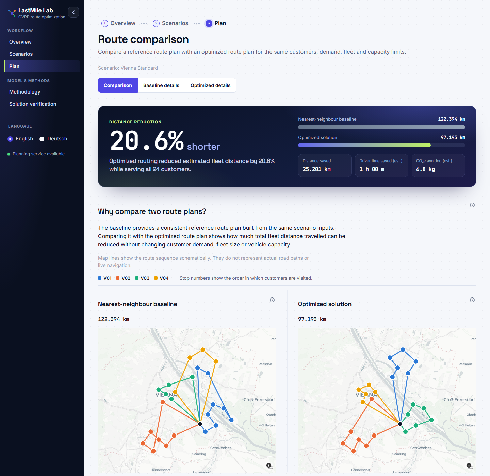
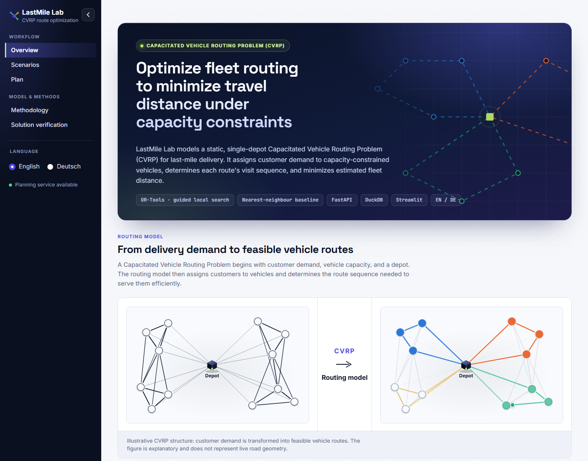
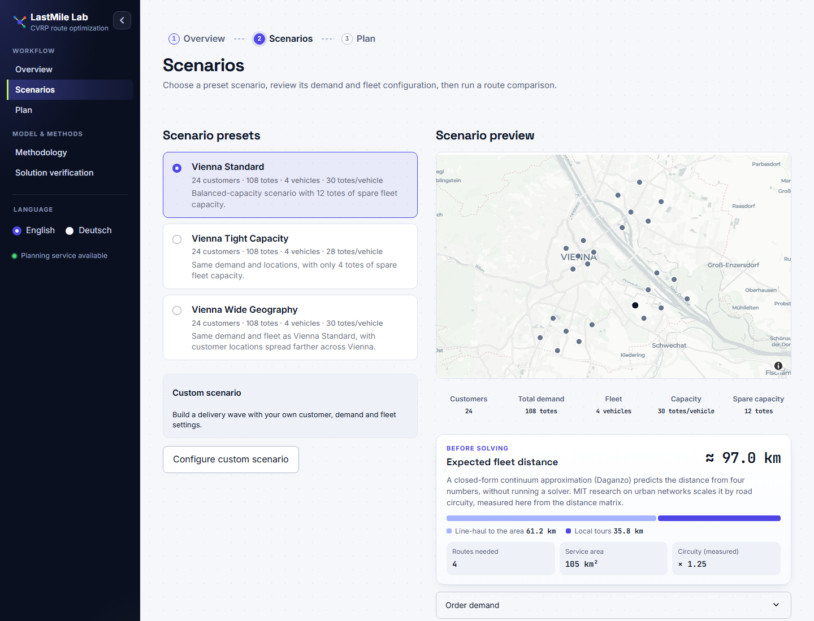
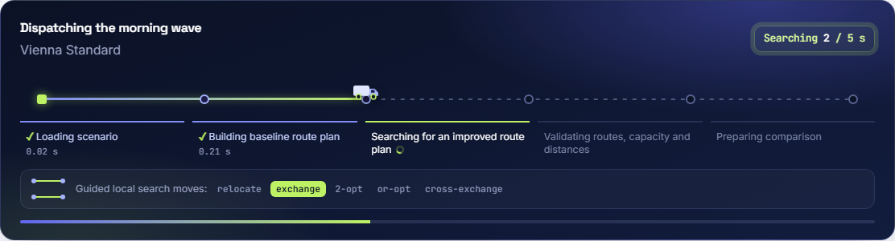
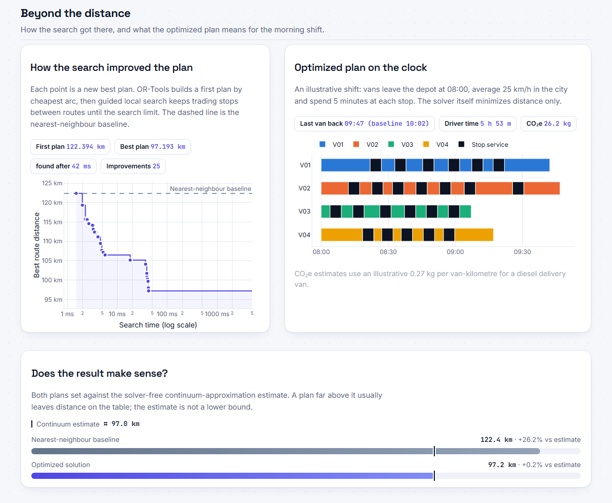
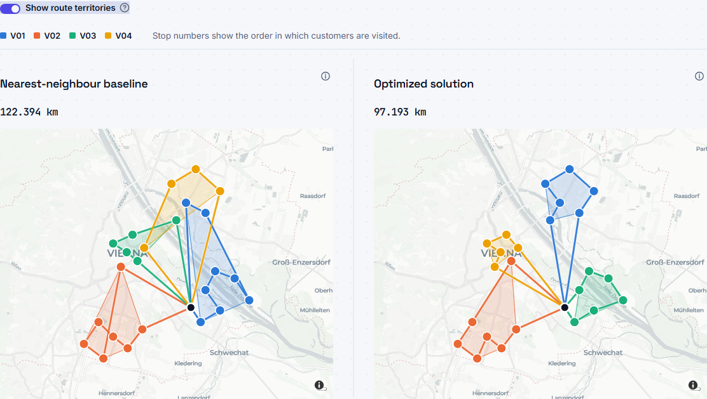
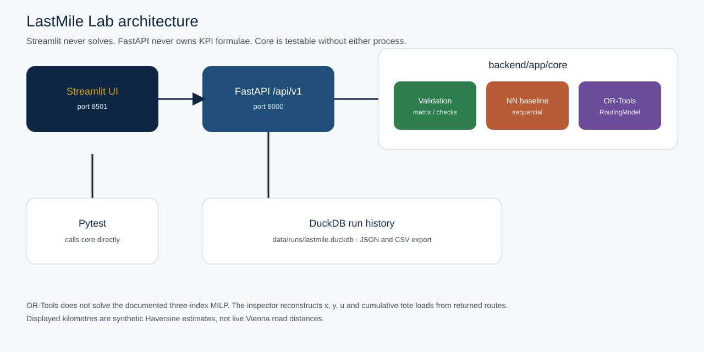

# LastMile Lab: ViennaCart CVRP Dispatch Planner

Static morning dispatch for a fictional last-mile operator: assign every unsplit tote order to one homogeneous van, sequence the stops, and compare a capacity-aware nearest-neighbour baseline with Google OR-Tools. Distances, assignments, and KPIs are reconcilable from the returned routes.

**Live demo:** [https://lastmilelab.streamlit.app/](https://lastmilelab.streamlit.app/)

> LastMile Lab is a fictional portfolio case study. ViennaCart is a fictional operator. All depots, customers, order demands, routes, distances, and operating assumptions are synthetic. The application does not use proprietary customer data or live Vienna traffic information.



*Vienna Standard 24 published comparison (4 September 2026): 122.394 km sequential nearest-neighbour versus 97.193 km OR-Tools in 5 seconds (20.6% shorter). The diagrams are an illustrative routing view, not road geometry or live traffic. Live app: [lastmilelab.streamlit.app](https://lastmilelab.streamlit.app/).*

## Live demo

The public UI is on Streamlit Community Cloud. Planning runs on a separate FastAPI service. Hosting notes: [`docs/deployment.md`](docs/deployment.md).

| Surface | URL |
|---|---|
| Streamlit planner | https://lastmilelab.streamlit.app/ |
| GitHub (source) | https://github.com/syeddanishali17/LastMileLab2 |

Local two-process development on this machine:

| Surface | Local URL |
|---|---|
| Streamlit planner | http://localhost:8501 |
| API health | http://127.0.0.1:8000/health |
| OpenAPI `/docs` | http://127.0.0.1:8000/docs |

Docker Compose publishes only Streamlit (`http://localhost:8501` by default). API health from Compose: `docker compose exec backend` as in [`docs/deployment.md`](docs/deployment.md).

### Application journey

**Overview → Scenarios → Plan.** Overview teaches the routing instance → feasible vehicle routes. Scenarios offers three presets — Vienna Standard, Tight Capacity, and Wide Geography — plus a custom tote-demand editor with live capacity checks. **Run comparison** runs the nearest-neighbour baseline and OR-Tools search, then opens Plan. That page heading is **Route comparison**; it opens with the headline reduction, then both maps, the search-convergence chart, a shift timeline, a continuum-approximation plausibility check, route tables, and JSON/CSV ZIP downloads. Scenarios also shows a solver-free distance estimate for the selected preset before anything runs.

Methodology and **Solution verification** (German: **Lösungsprüfung**) are secondary pages. The collapsible sidebar holds that navigation and the English/Deutsch control. The footer has LinkedIn, GitHub, and email. Start the UI with `streamlit run frontend/Home.py`.

## Contents

1. [Business problem](#business-problem)
2. [MVP assumptions](#mvp-assumptions)
3. [Demand and capacity](#demand-and-capacity)
4. [Vienna Standard 24 demo](#vienna-standard-24-demo)
5. [Application screenshots](#application-screenshots)
6. [Architecture](#architecture)
7. [Mathematical formulation](#mathematical-formulation)
8. [Methodology and synthetic data](#methodology-and-synthetic-data)
9. [Technology stack](#technology-stack)
10. [Local setup (Windows PowerShell)](#local-setup-windows-powershell)
11. [Tests](#tests)
12. [API](#api)
13. [Limitations](#limitations)
14. [Roadmap](#roadmap)
15. [Licence](#licence)

---

## Business problem

ViennaCart is a fictional same-day e-commerce operator with one urban depot. At the start of the morning wave the planner knows every order, every customer location, every tote demand, and the available homogeneous vans. Each van loads once, runs one route, and returns to the same depot.

The application answers:

> How should ViennaCart assign mandatory customer orders to its available vans and sequence the deliveries so that every order is served without exceeding van capacity, while minimising total distance travelled?

It is decision support for one frozen planning period. It is not live traffic control.

## MVP assumptions

| Decision | Rule |
|---|---|
| Depot | One depot |
| Fleet | Identical vans; a van may remain unused |
| Demand | Integer delivery totes; one customer, one van, full order |
| Service | Every customer must appear exactly once |
| Split deliveries | Not allowed |
| Trips | One route per vehicle; start and end at the depot |
| Distance | Symmetric integer-metre matrix; display km to 3 decimals |
| Objective | Minimise total route distance, including depot return legs |
| Planning | Static, deterministic, one period |
| Solver | Google OR-Tools `RoutingModel` |

If one order exceeds van capacity, or total demand exceeds fleet capacity, the scenario is `infeasible` and the solver is not run. If those checks pass but search returns no complete plan, the status is `no_solution_found` — not a proof of infeasibility. The optimiser never silently drops a customer.

Out of scope for this release: time windows, live traffic, split deliveries, multi-trips, multiple depots, heterogeneous vehicles, optional customers, authentication, and Mapbox. Full list: [`docs/limitations.md`](docs/limitations.md).

## Demand and capacity

A tote is one reusable order container. Demand and capacity share that integer unit so packing is auditable without converting litres or kilograms.

Vienna Standard 24:

| Quantity | Value |
|---|---:|
| Customers | 24 |
| Total demand | 108 totes |
| Fleet | 4 vans × 30 totes |
| Fleet capacity | 120 totes |
| Spare capacity | 12 totes |
| Zone Z1 demand | 35 totes |
| Zone Z2 demand | 29 totes |
| Zone Z3 demand | 24 totes |
| Zone Z4 demand | 20 totes |

Z1 (35 totes) does not fit on one 30-tote van. The planner cannot assign one van per geographic zone; at least one Z1 customer must ride with another route. That is the intended CVRP challenge.

The Scenarios page also offers two further curated presets with the same 108-tote demand: **Tight Capacity** (4 vans × 28 totes, 4 totes spare) and **Wide Geography** (same fleet as Standard, stops spread farther across Vienna).

## Vienna Standard 24 demo

Computed on 4 September 2026 from `plan_baseline("VIENNA_STANDARD_24")` and `plan_optimise("VIENNA_STANDARD_24", time_limit_seconds=5)`.

| Item | Value |
|---|---|
| OR-Tools | `ortools==9.11.4210` |
| First solution | `PATH_CHEAPEST_ARC` |
| Local search | `GUIDED_LOCAL_SEARCH` |
| Time limit | **5 seconds** |
| Baseline status | `feasible`, `comparison_eligible` |
| Optimised status | `feasible`, `solver_termination=success` |
| Customers served | 24 / 24 on both plans |
| Vehicles used | 4 / 4 |

| KPI | Baseline (sequential NN) | OR-Tools (5 s) |
|---|---:|---:|
| Total distance | **122.394 km** (122394 m) | **97.193 km** (97193 m) |
| Distance improvement | — | **20.6%** |
| Used-fleet utilisation | 90.0% | 90.0% |
| Van loads (totes) | 29 / 28 / 29 / 22 | 29 / 29 / 20 / 30 |

Improvement is `100 × (122394 − 97193) / 122394 = 20.590…%`, displayed to one decimal as in the UI.

The OR-Tools plan is the **best feasible solution found within the configured search limit**. It is not a globally optimal claim. Guided local search is not bit-deterministic; a later run on another machine may differ slightly. The nearest-neighbour kilometres and sequences are deterministic and covered by tests. Raw publish-time payload: [`docs/screenshots/vienna_standard_24_publish.json`](docs/screenshots/vienna_standard_24_publish.json).

### Baseline routes (deterministic)

| Van | Load | Distance | Sequence |
|---|---:|---:|---|
| V01 | 29 | 34.174 km | Depot → C022 → C020 → C019 → C024 → C021 → C023 → C009 → C007 → Depot |
| V02 | 28 | 32.572 km | Depot → C017 → C014 → C013 → C015 → C018 → C016 → C005 → Depot |
| V03 | 29 | 24.503 km | Depot → C003 → C001 → C002 → C004 → C012 → Depot |
| V04 | 22 | 31.145 km | Depot → C006 → C008 → C010 → C011 → Depot |

### OR-Tools routes (publish-time snapshot, 5 s)

| Van | Load | Distance | Sequence |
|---|---:|---:|---|
| V01 | 29 | 30.101 km | Depot → C009 → C011 → C010 → C008 → C007 → C012 → Depot |
| V02 | 29 | 29.930 km | Depot → C017 → C014 → C013 → C016 → C018 → C015 → C003 → Depot |
| V03 | 20 | 15.466 km | Depot → C022 → C020 → C023 → C021 → C024 → C019 → Depot |
| V04 | 30 | 21.696 km | Depot → C005 → C001 → C002 → C004 → C006 → Depot |

V04 is loaded to capacity (30/30). That is reconstructed tote demand, not an MTZ potential.

## Application screenshots

The Plan capture at the top of this README is the live Streamlit UI. Walk every page — Overview, Scenarios, Plan, Methodology, and Solution verification — at [https://lastmilelab.streamlit.app/](https://lastmilelab.streamlit.app/).

**Overview.** An animated street-grid hero and the instance-to-routes explainer.



**Scenarios.** Presets, a live map preview and a solver-free distance estimate. While the comparison runs, a dispatch console drives a van one stop per planning stage, shows each stage's measured time, counts the OR-Tools search seconds while cycling its local-search moves, and ends on the found distance before opening Plan.





**Plan, beyond the distance.** How guided local search improved the plan over time, the optimized plan on a shift clock, a plausibility check against the continuum-approximation estimate, and whether a dispatcher would accept each plan as drawn.



**Route territories.** A toggle shades each van's convex hull: the baseline's territories overlap, the optimized plan's do not.



### Analytical read-outs

| Read-out | What it shows | Basis |
|---|---|---|
| Search convergence | Best-so-far distance after each improving OR-Tools solution, on a log time axis | `search_trace` recorded by a `RoutingModel.AddAtSolutionCallback` (strict improvements only) |
| Continuum-approximation estimate | Expected fleet distance **before** solving: `L ≈ c · (2·r̄·m + k·√(n·A))` | Daganzo (1984), k ≈ 0.57; circuity `c` measured from the scenario matrix after Merchán & Winkenbach, MIT CTL ([DSpace 1721.1/140763](https://dspace.mit.edu/handle/1721.1/140763), thesis [1721.1/119911](https://dspace.mit.edu/handle/1721.1/119911)) |
| Dispatcher acceptance | Route crossings, territory (convex-hull) overlap, route spread and zone switches for both plans, plus a map overlay of each van's territory | Visual-attractiveness criteria reviewed by Rossit, Vigo, Tohmé & Frutos, *Computers & Operations Research* 103 (2019) ([repository copy](https://ri.conicet.gov.ar/handle/11336/103527)); zone-by-zone driver behaviour from the Amazon Last Mile Routing Research Challenge ([Wu et al., arXiv 2205.04001](https://arxiv.org/abs/2205.04001)) |
| Shift timeline | Each van's drive legs and stops on a clock from 08:00 | Illustrative 25 km/h and 5 min per stop; the solver still minimizes distance only |
| Driver time and CO₂e | Estimated hours and emissions saved versus the baseline | Illustrative 0.27 kg CO₂e per van-km for a diesel delivery van |

On Vienna Standard 24 the optimized plan also scores better on every dispatcher measure (1 crossing vs 3, no territory overlap vs 3.2%, 1 zone switch vs 4), although OR-Tools only targets distance. The estimate is **97.0 km** before any solving; OR-Tools returns 97.193 km (+0.2%) and the nearest-neighbour baseline 122.394 km (+26.2%). The estimate is a plausibility check, not a bound.



*Streamlit never solves. FastAPI never owns KPI formulae. Pytest calls `backend/app/core` directly.*

## Architecture

```text
Browser → Streamlit (published :8501) → FastAPI /api/v1 (internal :8000)
                              ├─ validation, Haversine matrix
                              ├─ sequential nearest neighbour
                              ├─ OR-Tools RoutingModel
                              ├─ KPIs and solution invariants
                              └─ DuckDB run history + JSON/CSV export
```

OR-Tools does **not** solve the documented three-index MILP. Solution verification reconstructs `x_ijk`, `y_ik`, and `u_k` from returned stop sequences. Displayed load is the cumulative tote sum, not MTZ `w_ik`.

Detail: [`docs/architecture.md`](docs/architecture.md).

## Mathematical formulation

The three-index CVRP with assignment-linked MTZ potentials is in [`docs/mathematical_formulation.md`](docs/mathematical_formulation.md).

That note includes the corrected inequality with right-hand side `Q_k − q_j y_jk`, a counter-example for the incorrect form, `u_k` linking, and the table mapping MILP symbols to reconstructed routes. It does not claim that OR-Tools solved the MILP as written.

Field catalogue: [`docs/data_dictionary.md`](docs/data_dictionary.md).

## Methodology and synthetic data

[`docs/methodology.md`](docs/methodology.md) records:

- why totes are the demand unit
- why split delivery is excluded
- why the MVP minimises distance rather than a financial cost
- Haversine construction: Earth radius `6371000`, detour factor, `floor(x + 0.5)`, triangle-and-mirror symmetry
- baseline tie-breaks and `comparison_eligible`
- OR-Tools unary demand callback and capacity dimension
- why a timeout is `no_solution_found`, not `infeasible`
- independent solution invariants
- why ordinary solver output is feasible rather than globally optimal
- why Checks 1 and 2 are necessary but not sufficient for unsplit feasibility

## Technology stack

| Piece | Pin / choice |
|---|---|
| Language | Python 3.12 |
| API | FastAPI 0.115.8, Uvicorn 0.34.0, Pydantic 2.10.6 |
| Solver | `ortools==9.11.4210` |
| UI | Streamlit 1.44.1, Plotly 5.24.1, OpenStreetMap tiles |
| Storage | DuckDB 1.2.2 |
| Tests / lint | pytest 8.3.5, ruff 0.11.2 |
| CI | GitHub Actions, Python 3.12 |
| Runtime | Docker Compose (API + UI together) |

No Mapbox token. No secrets in `.env.example`.

## Local setup (Windows PowerShell)

```powershell
cd c:\Users\danis\Desktop\LastMileLab2
py -3.12 -m venv .venv
.\.venv\Scripts\python.exe -m pip install --upgrade pip
.\.venv\Scripts\python.exe -m pip install -r backend\requirements.txt -r backend\requirements-dev.txt -r frontend\requirements.txt
```

Terminal 1 — API:

```powershell
.\.venv\Scripts\python.exe -m uvicorn app.main:app --app-dir backend --reload --host 127.0.0.1 --port 8000
```

Terminal 2 — UI:

```powershell
.\.venv\Scripts\python.exe -m streamlit run frontend\Home.py
```

More detail: [`docs/local_setup.md`](docs/local_setup.md). Compose: [`docs/deployment.md`](docs/deployment.md).

## Tests

```powershell
cd c:\Users\danis\Desktop\LastMileLab2
.\.venv\Scripts\python.exe -m pytest -q
.\.venv\Scripts\python.exe -m ruff check backend tests frontend
```

CI runs the same commands on Python 3.12 (`.github/workflows/ci.yml`). Tests call core planning directly; they do not require a running Uvicorn process.

Vienna optimiser kilometres are intentionally **not** frozen. An enumerated six-customer fixture remains in tests and docs only; it is not in the Streamlit scenario selector.

## API

Interactive docs when the API is running locally: [http://127.0.0.1:8000/docs](http://127.0.0.1:8000/docs). Compose keeps FastAPI internal. The public demo uses a Render service behind Streamlit; see [`docs/deployment.md`](docs/deployment.md).

| Method | Path | Role |
|---|---|---|
| `GET` | `/health` | Liveness |
| `GET` | `/api/v1/scenarios` | List fixtures |
| `GET` | `/api/v1/scenarios/{id}` | Depot, customers, matrix, pre-checks |
| `POST` | `/api/v1/scenarios/generate` | Synthetic geographic scenario |
| `POST` | `/api/v1/scenarios/validate` | Pre-checks only |
| `POST` | `/api/v1/plans/baseline` | Sequential nearest neighbour |
| `POST` | `/api/v1/plans/optimise` | OR-Tools (`solver_time_limit_seconds` 1, 5, or 10); the summary includes `search_trace` |
| `GET` | `/api/v1/runs/{run_id}` | Stored plan and KPIs |
| `GET` | `/api/v1/runs/{run_id}/routes` | Sequences and stops |
| `GET` | `/api/v1/runs/{run_id}/checks` | Reconstructed constraint checks |
| `GET` | `/api/v1/runs/{run_id}/export` | JSON or CSV zip |

Streamlit is a client of this API. It does not re-solve the CVRP.

## Limitations

- Distances are synthetic Haversine estimates with a detour factor, not live Vienna roads.
- Ordinary OR-Tools output is feasible within a time limit, not globally optimal.
- No time windows, split deliveries, dropped customers, or heterogeneous fleet.
- No public authentication; fixtures must stay synthetic.
- Shift times, driver hours and CO₂e on the Plan page are display-side estimates from stated assumptions; they are not optimized.
- The free demo stores planning runs on ephemeral Render disk; presets remain, stored custom runs may disappear after a backend restart.

Full write-up and versioned extensions: [`docs/limitations.md`](docs/limitations.md).

## Roadmap

| Release | Intent |
|---|---|
| V1.1 | CSV upload, saved comparison, fleet what-if, cached road-network matrix |
| V1.2 | Heterogeneous capacities, fixed dispatch cost, workload-balance reporting |
| V2 | Time windows, service duration, driver shift length |
| V3 | Optional customers, split-delivery experiment, multi-trip experiment |

These remain out of scope for the current CVRP MVP.

## Licence

[MIT](LICENSE). Copyright (c) 2026 SyedDanishAli.

Source: [github.com/syeddanishali17/LastMileLab2](https://github.com/syeddanishali17/LastMileLab2). Live UI: [lastmilelab.streamlit.app](https://lastmilelab.streamlit.app/).
